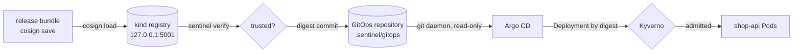

# The demo cluster (kind)

Task A5b, SPEC §7, ADR-0011 decision 5. A local Kubernetes cluster where only SentinelCI releases run:
- the Kyverno admission controller admits an image only if `sentinel verify` would trust it, with the policy
  that `sentinel admission-policy` renders (#45);
- Argo CD deploys the demo-shop release from a local GitOps repository, by digest, and only after
  `sentinel verify` trusted it.



## Prerequisites

- Docker, `kubectl` and git, from the machine. `kubectl` must be within one minor version of the cluster's
  Kubernetes (v1.36 to v1.38 for the v1.37.0 node image), the skew Kubernetes supports. `make kind-up` checks
  Docker and kubectl before it creates anything, and stops with what to install.
- kind and Cosign, pinned by sha256 in `tools.lock.toml`: `uv run sentinel tools install kind cosign` (or
  `make tools`). Each is verified again before it runs.

## Commands

```bash
make kind-up        # registry, GitOps repository, cluster, Kyverno, Argo CD, git server (safe to run twice)
make kind-policy    # render the release admission policy from deploy/keys/release.pub and apply it
make demo-release   # deploy the release bundle out/release/bundle through GitOps (safe to run twice)
make kind-down      # delete the cluster and its registry (the GitOps repository is kept)
```

`make kind-policy KEY=path/to/release.pub` and `make demo-release KEY=... BUNDLE=...` use another public key
and bundle. The release key pair and the bundle are made by `make release` (A4c); until then, a test key and
a bundle from `cosign save` do.

## What `make kind-up` does

1. Issues the registry's TLS certificate with OpenSSL 3, once: a CA made for this cluster only signs a
   certificate for `kind-registry`, `localhost` and `127.0.0.1`, then its key is deleted. Both certificates
   and the registry's key stay in `.sentinel/kind/tls/` (git-ignored, never committed).
2. Starts the registry container (`kind-registry`), published on **127.0.0.1:5001 only**, serving TLS with
   that certificate. A registry an older `make kind-up` started over plain HTTP is refused: `make kind-down`,
   then `make kind-up`.
3. Creates the GitOps repository, `.sentinel/gitops/demo-shop.git` (bare, branch `main`, empty), if it is
   missing.
4. Creates the cluster `sentinel` from `kind-config.yaml` (kubectl context `kind-sentinel`). Its API server
   listens on 127.0.0.1. `.sentinel/gitops` is mounted **read-only** into the node at `/sentinel-gitops`; a
   cluster made by an older `make kind-up`, without that mount, is refused (`make kind-down` first).
5. Tells containerd on each node that `kind-registry:5000` and `localhost:5001` are that registry, over HTTPS
   with the cluster's CA (`/etc/containerd/certs.d/<host>/hosts.toml`, pull and resolve only).
6. Connects the registry to the cluster's network and documents it (KEP-1755's `local-registry-hosting`
   ConfigMap).
7. Installs Kyverno, gives its admission controller the cluster's CA (a ConfigMap mounted as `SSL_CERT_DIR`,
   next to the system's CAs), then installs Argo CD core, from their pinned manifests, and waits until they
   are available. Both manifests are checked before either is applied.
8. Applies `deploy/argocd/git-server.yaml` (the GitOps git server) and `deploy/argocd/demo-shop-namespace.yaml`
   (Pod Security "restricted"), and waits for the git server.

**Why TLS:** Kyverno 1.19 fetches cosign's bundles over HTTPS whatever `allowInsecureRegistry` says
([kyverno/kyverno#18350](https://github.com/kyverno/kyverno/pull/18350), not merged). Over plain HTTP, it
read no signature and denied every image, the good release too (Hiba's kind run, #60). With TLS, the policy
needs no insecure flag at all.

**Registry names:**
- From the host, the registry is `127.0.0.1:5001`, over TLS: that is where `cosign load` loads and
  `sentinel verify` reads, trusting the cluster's CA through `SSL_CERT_FILE` (a bundle of the system's CAs
  and `.sentinel/kind/tls/ca.crt`, which `make demo-release` makes).
- In the cluster, the same images are `kind-registry:5000/...`. The chart uses that name, and the admission
  policy matches it, rendered with `--image-glob 'kind-registry:5000/demo-shop/*'` and no insecure flag.
- The attestations bind a release to its digest and its source repository, not to a registry host. So a
  release pushed from the host is verified by Kyverno under the cluster's name.

## What `make demo-release` does

`deploy/kind/demo.py release`, in order; nothing past a failed step runs:

1. **The bundle** (`out/release/bundle`, written by `make release` with `cosign save`) must name exactly one
   image, whose manifest is in it with that digest.
2. **The cluster's policy** must be the one rendered from `--key` for this repository and the laptop
   release's builder (the server's defaults aside). Otherwise: `make kind-policy KEY=...` first. So Kyverno
   trusts exactly what step 4 trusts.
3. **`cosign load`** pushes the bundle into the cluster's registry, over TLS: the image, its signature and its
   four attestations, digest unchanged. Without `.sentinel/kind/tls/ca.crt` (no `make kind-up` yet), nothing
   runs.
4. **`sentinel verify`** checks it there, in registry mode. Exit `1` if it is not trusted: nothing is
   committed.
5. **The GitOps commit.** The chart (`deploy/helm/demo-shop`) and `release.yaml` (the digest) are committed to
   the GitOps repository's `main`, with the trailers `Sentinel-Image` and `Sentinel-Source` (the checkout's
   commit). The same release twice makes no commit.
6. **Argo CD.** `deploy/argocd/project.yaml` and `application.yaml` are applied, and the application is
   refreshed. Argo CD must sync that commit and report it healthy; a sync that fails (Kyverno's denial, for
   instance) stops the release with Argo CD's message.
7. **The rollout.** `kubectl rollout status`, then the Deployment must run exactly
   `kind-registry:5000/demo-shop/shop-api@<digest>`.

Exit codes: `0` deployed, `1` not trusted by `sentinel verify`, `3` anything else failed.

### The GitOps repository and its server

- **Local only.** It lives on the laptop, in `.sentinel/gitops` (git-ignored). Nothing is pushed to GitHub,
  and the cluster holds no credential (ADR-0011). `demo-shop/gitops/` stays a seeded scan target.
- **Read-only, three times.** The node's mount and the Pod's mount are read-only, and `git daemon` serves
  upload-pack only (`--forbid-override=receive-pack`).
- **One repository.** `--strict-paths` serves exactly `/srv/git/demo-shop.git`, which must hold
  `git-daemon-export-ok`.
- **One client.** A NetworkPolicy lets only Argo CD's repo server in, on port 9418, and lets nothing out.
- **No new image.** The server runs Argo CD's own image, which ships git; a test keeps it the image of the
  pinned Argo CD version.
- **What it costs.** The `hostPath` volume means the `sentinel-gitops` namespace cannot enforce Pod Security
  "baseline". The repository's files belong to the laptop's user, so `safe.directory` admits them, from the
  command scope (`GIT_CONFIG_*`).

### What Argo CD may do

The `demo-shop` AppProject allows:
- one source, the GitOps repository;
- one destination, the `demo-shop` namespace;
- the chart's three kinds: Deployment, Service and ServiceAccount;
- nothing cluster-scoped. The namespace is made by `make kind-up`, with Pod Security "restricted".

The Application syncs automatically, with prune and self-heal.

### The chart (`deploy/helm/demo-shop`)

- The image by digest only. `values.schema.json` refuses a missing or malformed digest, and the template
  refuses an empty one even without the schema.
- The release image's contract (ADR-0011, decision 6): UID 10001, port 8080, health at `GET /healthz`, writes
  only to `/tmp` (an `emptyDir`).
- Pod Security "restricted": non-root, `RuntimeDefault` seccomp, no privilege escalation, all capabilities
  dropped, a read-only root file system.
- No service-account token mounted.

## Pins

| What | Where | How |
|---|---|---|
| kind 0.33.0 | `tools.lock.toml` | sha256 of each release binary, from its `.sha256sum` file |
| Node image (Kubernetes 1.37.0) | `kind-config.yaml` | digest: kind 0.33.0's default (`pkg/apis/config/defaults/image.go`) |
| Registry (`registry:3.1.2`) | `cluster.toml` | digest of the official image index (docker-library/repo-info) |
| Kyverno 1.19.2 | `cluster.toml` | sha256 of the release's `install.yaml` |
| Argo CD 3.6.1 (core) | `cluster.toml` | sha256 of `manifests/core-install.yaml` at the release tag |
| GitOps git server | `deploy/argocd/git-server.yaml` | Argo CD's image, at the pinned Argo CD version |

`tests/deploy/test_kind.py` checks every pin:
- the images are pinned by tag and digest;
- each manifest is a release asset, or a file at the release tag, of its version, with a sha256;
- the cluster's Kyverno is the release of the Kyverno CLI that the admission tests run;
- the git server's image is the pinned Argo CD's.

A downloaded manifest whose sha256 differs is deleted and refused, before anything is applied. To upgrade,
change the version and the pin together in one PR, and say in its description where each value comes from.

## Tests

| Test | Needs | What it checks |
|---|---|---|
| `tests/deploy/test_kind.py` | nothing | The pins; `up`, `down` and `policy` against a recording fake: the loopback binding, both registry names, the GitOps mount, the install order, a second `up` that keeps what exists, a cluster without the mount, a manifest that is not the pinned one. The git server's own command and environment, run with the local `git daemon`: it serves the one repository, even when another user owns it, and refuses a push. |
| `tests/deploy/test_demo.py` | git | `make demo-release`'s steps against a fake cluster, with real git: their order; the GitOps commit and its content; no second commit; nothing committed when `sentinel verify` refuses or the policy is not the key's; a Kyverno denial during the sync; a timeout; another image running. That the Argo CD files name the same repository, chart path, values file and namespace as the git server and `demo.py`. |
| `tests/deploy/test_chart.py` | Go | The chart rendered as Helm renders it (`chart_render.py`: values merged and checked against the schema, templates run by Go's own `text/template` with Helm's `required`, any other function an error): the three resources the AppProject allows, the image by digest, Pod Security "restricted", the release image's contract, and the values it refuses. |
| `cli/tests/supplychain/test_demo_bundle.py` | pinned tools | A real release saved with `cosign save`: `demo.py` reads its digest, loads it into another registry and `sentinel verify` trusts it there; the other key and an unsigned image are not trusted. |
| `cli/tests/supplychain/test_admission.py` | pinned tools, Go | The chart's Deployment, rendered for a real registry, admitted by the Kyverno CLI for a release and refused for an unsigned image. |
| `cli/tests/supplychain/test_kind_admission.py` | a cluster | On server-side dry runs, Kyverno **admits** a release that `sentinel attest --push` attested, and **denies**, each with the policy's own message, an unsigned image, a BLOCK decision signed with the release key, and a Deployment with an unsigned image. |
| `cli/tests/supplychain/test_kind_demo.py` | a cluster, Go | `make demo-release`'s steps on a release that runs (a static health server on 8080 as UID 10001, attested and saved): Argo CD syncs the GitOps commit, the Deployment runs that digest and is ready, a second release changes nothing, another key is refused at the policy check. |

The cluster tests are opt-in (`SENTINEL_KIND_CONTEXT=kind-sentinel` and `SENTINEL_TOOLS_DIR`). **The
`sentinel-kind` workflow** creates the cluster with `make kind-up` and runs both. It runs by hand, and on pull
requests that change the cluster's setup, the demo's deploy or the admission policy. It takes about fifteen
minutes, so it does not run on every push (GitHub Free minutes).

## Limits

- Kyverno's and Argo CD's install manifests name their images by tag (`reg.kyverno.io/...:v1.19.2`,
  `quay.io/argoproj/argocd:v3.6.1`, Redis from `public.ecr.aws`). The manifests are pinned by sha256; the
  images are not pinned by digest yet.
- Kyverno's default install does not check its own namespace (`kyverno`) or `kube-system`. Whoever can create
  Pods there is out of the policy's reach. The same goes for Argo CD's own images in `argocd`, and the git
  server in `sentinel-gitops`: the policy covers the demo's images (`kind-registry:5000/demo-shop/`).
- The chart is rendered by Argo CD's Helm in the cluster. Without a cluster, the tests render it with Go's
  `text/template`, the engine Helm uses, and allow no Helm function but `required`; Helm itself is not run.
- Next step (A5b): `make demo-attack`, the refused cases shown on the running cluster.
