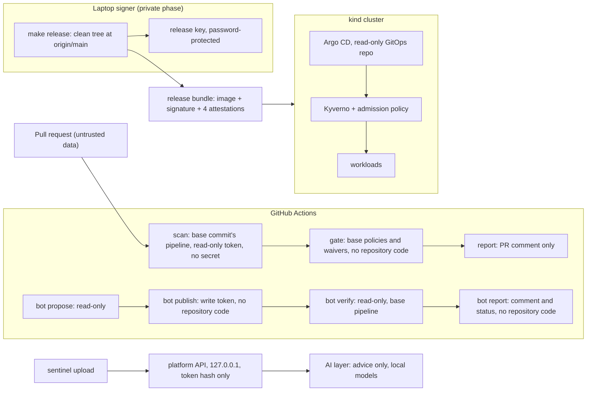

# SentinelCI threat model

What SentinelCI defends, against whom, and where each defence lives and is tested. It complements SPEC §18
(project risks) and the ADRs, which record why each control was chosen. Status: **main** (merged), **PR #n**
(written and tested, not merged yet), **planned** (not written).

## 1. What is worth attacking

| Asset | Why it matters |
|---|---|
| The release decision (PASS, WARN, BLOCK) | It is what lets an image ship. A forged or wrongly computed PASS ships a vulnerable image |
| The pipeline that judges a change | The CLI, `tools.lock.toml`, the policies, the waivers. Whoever controls it controls the decision |
| The security tools | A tampered scanner can stay silent, or steal what the job can reach (the Trivy incident of March 2026) |
| The release signing key | With it, anything can be made to look released |
| The signed release and its evidence | Image, signature and the four attestations (decision, SBOM, vulnerability scan, provenance) |
| The cluster | What finally runs |
| Findings and decisions stored by the platform | Evidence; findings may describe secrets (never their values) |
| Repository write access | `main` has no server-side protection in the private phase (ADR-0006) |

## 2. Who attacks

- **A1, the outside contributor**: opens a pull request with any content, including workflows, code that
  runs in CI, scanner configuration files and comments meant for an AI.
- **A2, the compromised dependency or tool**: a scanner release, a GitHub Action, a Python package or a
  container base image turned malicious upstream.
- **A3, the malicious or confused AI output**: a model that follows instructions hidden in finding text, or
  invents a fix.
- **A4, the attacker inside the network path**: a proxy, a redirect, a registry that serves something else.
- **A5, the insider with push rights**: one of the two team members, or a session acting for one. In the
  private phase this attacker is accepted as a residual risk (section 5).

## 3. Trust boundaries

Data crosses each arrow; code and credentials do not. A job that runs repository code never holds a write
token or a secret, and a job that holds one runs no repository code.

## 4. Threats and controls

### 4.1 Pipeline: a change must not judge itself

| # | Threat (attacker) | Control | Where | Proof | Status |
|---|---|---|---|---|---|
| T1 | A pull request runs code with secrets or a write token ("pwn request") (A1) | No `pull_request_target`; the scan job has `contents: read` and no secret; only the report job can write, and only a comment | `.github/workflows/sentinel-scan.yml`, ADR-0008 | `tests/ci/test_workflows.py` (permissions, no `pull_request_target`, no persisted token) | main |
| T2 | A pull request edits the CLI, the lock, the policies, the waivers, the VEX document or `sentinel.yaml` that judge it (A1) | Every job checks out the pipeline at the base commit; the change is checked out only as data, never run. The PR comment lists the pipeline files the change touches | ADR-0008, `sentinel-scan.yml` | `test_the_pipeline_change_warning_covers_every_input_read_from_the_base_commit` | main |
| T3 | A pull request silences a scanner: `.gitleaks.toml`, `.gitleaksignore`, `gitleaks:allow`, `.trivyignore`, `zizmor.yml`, `# zizmor: ignore`, `.gitattributes` (A1) | Each adapter passes SentinelCI's own configuration, an empty ignore location, offline flags; inline allow comments are not honoured | `cli/src/sentinelci/scanners/{gitleaks,trivy,zizmor}.py` | planted `.gitleaksignore`, `.trivyignore` and `.gitattributes` in `test_gitleaks_scan.py`, `test_trivy_scan.py`; zizmor's in `test_zizmor_scan.py` | main |
| T4 | A pull request drops a scanner step from the workflow it carries (A1) | The required scanners come from the base policies (`required_tools.rego`); a missing one is SC-010 | `policies/required_tools.rego`, `gate.rego` | `gate_test.rego` (SC-010 cases) | main (all six in `pr` and `release`: Gitleaks, Trivy and zizmor, then Opengrep, Syft and Grype with #114) |
| T5 | A secret is added, then removed, inside one pull request (A1) | Gitleaks scans every commit of the pull request (`base..head`) as patches | `sentinel-scan.yml` | git-mode tests in `test_gitleaks_scan.py` (text patches forced, octopus merges) | main |
| T6 | Only what the change introduces should block, but a failed baseline must not hide anything (A1) | Diff-aware gating against the base commit's scan; without a baseline every finding counts | `sentinel-scan.yml`, SPEC §5 | `test_the_pr_gate_and_its_baseline_run_the_same_scanners` | main |
| T7 | A contributor waives their own finding, declares it `not_affected` in VEX, or lowers its service's exposure in `sentinel.yaml` (A1) | Waivers, the VEX document and `sentinel.yaml` are read from the base commit; a waiver needs an owner, a justification and expires within 90 days, or it is SC-005; a `not_affected` statement needs a justification and expires 90 days after it was made; a statement or document dated after `evaluated_at` blocks (SC-010); a statement of any other status disputes it; secrets are never covered | `policies/gate.rego`, `.sentinel/waivers.yaml`, `.sentinel/vex.json`, `sentinel.yaml` | `gate_test.rego` (SC-005 and VEX cases) | main |
| T8 | A CI workflow introduces a dangerous pattern (A1) | zizmor audits the workflows of every change, with no configuration, ignore comment or workflow lockfile of the scanned repository honoured (`--no-config`, `--no-ignores`, `--ignore-lockfile`); a new high-severity issue is SC-009 | `sentinel scan pipelines`, `sentinel-scan.yml` | GT-PIPELINE-001 to 003 give SC-009; `gate_test.rego` (SC-009 cases); `test_a_workflow_lockfile_of_the_scanned_repository_silences_nothing` | main; `--ignore-lockfile` (zizmor 1.32): PR #119 |

### 4.2 Tools and dependencies: trust nothing that was downloaded

| # | Threat (attacker) | Control | Where | Proof | Status |
|---|---|---|---|---|---|
| T9 | A scanner release is replaced upstream (A2) | `tools.lock.toml` pins each binary by sha256 (and Opengrep by its signature); the binary is re-hashed right before every run; a mismatch never runs and is SC-010 | `cli/src/sentinelci/scanners/lock.py`, `runner.py` | `test_install_verify.py`, `test_runner.py`, `test_status.py` | main |
| T10 | A scanner crashes, times out or reports nothing, and silence reads as a pass (A2) | Every scanner writes a tool status on failure too; any status other than `ok` is SC-010; each run has a time limit the job outlives | `scanners/status.py`, `gate.rego` | crash, timeout and integrity tests; `test_the_scan_job_outlives_every_scanner_run` | main |
| T11 | A GitHub Action tag is moved to malicious code (A2) | Every action is pinned by full commit SHA with its version comment | all workflows | `test_every_reference_exists_or_is_pinned_by_commit_sha` | main |
| T12 | A malicious Python package or update (A2) | `uv.lock` with hashes, dependencies added only with `uv add` and justified; Dependabot waits 7 days before proposing an update | `uv.lock`, `.github/dependabot.yml` | `uv sync --locked` in CI | main |
| T13 | A container base image changes under its tag (A2) | Compose images are pinned by tag and digest; the release image's base is pinned by digest (ADR-0011) | `deploy/compose/compose.yaml`, `demo-shop/services/shop-api/Dockerfile.release` | `tests/deploy/test_compose.py`, `tests/demo_shop/test_release_dockerfile.py` | main |
| T30 | A cache entry written by another run, or by the pull request's own workflows (under any key: actions/cache extracts a whole entry with `tar -P` relative to the workspace, before any check), changes what a job runs or overwrites the pipeline checkout (A1, A2) | The scan and the gate restore the archives only outside pull requests, where only the base branch's runs wrote the cache, and never with `restore-keys`; only the scanners' release archives are cached, and `sentinel tools install` then re-checks each against the lock's sha256 and extracts the binary again; no binary or package-manager cache is kept by a job that judges a change; no job with a write permission restores a cache | ADR-0015, `sentinel-scan.yml`, `ci.yml` | `tests/ci/test_caching.py` (`test_a_job_that_judges_restores_no_cache_in_a_pull_request`); a corrupted cached archive is downloaded again in `test_install_verify.py` | PR #105 |

### 4.3 Release: only what the gate allowed can run

| # | Threat (attacker) | Control | Where | Proof | Status |
|---|---|---|---|---|---|
| T14 | The signing key is stolen from CI, or the laptop signer is made to sign what the gate blocks (A1, A5) | The release key never reaches GitHub; the laptop signer (`make release`) refuses unless the tree is clean at `origin/main`, with one `origin` URL and no file git ignores under `policies/`, and builds from the commit; every scanner of the release must report before the gate decides; the password is asked on the terminal and given only to the two processes that use the key, which must be the pair of the committed public key | ADR-0011, `deploy/release/release.py` | `tests/deploy/test_release.py` (preconditions, a scan that leaves no status, an ignored policy file, the key pair), `tests/deploy/test_release_tools.py` (real tools) | main |
| T15 | A BLOCK image gets signed (A5, A2) | `sentinel attest` refuses a BLOCK or non-release decision, or a decision about another digest | `supplychain/attestations.py` | `cli/tests/supplychain/test_attestations.py` | main |
| T16 | An unsigned, tampered or BLOCK image is deployed (A1, A4) | `sentinel verify` checks the signature and the four attestations; Kyverno applies the same checks at admission; a native admission policy only admits release images in the demo namespace | `supplychain/verify.py`, `deploy/kyverno`, ADR-0011 | `test_verify.py`; admission tests with the Kyverno CLI; `make demo-attack` (5 attacks) | verify and the admission policy: main; the cluster: PR #60 to #62 |
| T17 | A registry or bundle serves another image under the right name (A4) | Everything is addressed by digest; the attest step re-reads the digest from the layout itself; Kyverno re-verifies at admission | ADR-0011 | registry-mode tests | main |
| T18 | The GitOps repository is edited to deploy something else (A5, A4) | A local bare repository served read-only inside kind (push refused); a NetworkPolicy lets only Argo CD's repo server reach it; admission still verifies whatever it deploys | `deploy/argocd` | `tests/deploy` and the kind end-to-end test of PR #61 | PR #61 |

### 4.4 Evidence: a decision can be checked later

| # | Threat (attacker) | Control | Where | Proof | Status |
|---|---|---|---|---|---|
| T19 | A decision is altered or cannot be reproduced (A5) | Each decision records the sha256 of every input; the evidence store keeps them; `sentinel replay` re-runs it, and a nightly job replays recent decisions | `policy/`, `replay-nightly.yml` | replay tests; nightly replay | main; the nightly job is stopped while Actions is blocked (§5) |
| T20 | Recorded evidence is replaced on the platform (A5) | The database refuses any change to a recorded run or its findings, and keeps the uploaded bytes only if they hash to the recorded digest | migrations 0002 to 0004 | `platform/api/tests` | main |

### 4.5 Platform API

| # | Threat (attacker) | Control | Where | Proof | Status |
|---|---|---|---|---|---|
| T21 | Unauthenticated or oversized writes (A1, A4) | Every port binds 127.0.0.1; writes need a bearer token, and the API only holds its sha256; bodies are capped before parsing or authentication | `platform/api`, `deploy/compose` | `test_ingest.py`, `test_compose.py` | main |
| T22 | The upload client leaks its token (A4) | The token comes only from `SENTINEL_API_TOKEN`; no redirect is followed; plain http (loopback only) never goes through a proxy; the token is never printed, even in errors | `report/upload.py` | `cli/tests/report/test_upload.py` (stub servers, proxies, redirects) | main |
| T23 | Metrics reveal what runs contain (A1) | Read-only aggregates, SPEC §10 names only, enumerated label values only (never a repository, commit or id) | `sentinel_api/metrics.py` | `test_metrics.py` | main |

### 4.6 AI: it advises, it never decides

| # | Threat (attacker) | Control | Where | Proof | Status |
|---|---|---|---|---|---|
| T24 | AI output changes a verdict, creates a waiver or merges (A3) | The decision path cannot import the AI package (import contract); AI output is advice stored next to the decision | `pyproject.toml` (`importlinter`), ADR-0004 | `lint-imports` in `make check` | main |
| T25 | Finding text or code carries a prompt injection (A1, A3) | Findings and code are sent as JSON lines inside delimited blocks, with `<` and `>` escaped, and each prompt names its blocks as data; no ids, snippets or evidence are sent; an answer is schema-checked, retried once, and never replaces a deterministic label; an explanation cites only the finding's own CWE, CVE and advisory ids; a code fix may edit only the lines it was shown | `ai/.../correlate/labels.py`, `ai/.../patch/code.py`, `ai/.../guardrails.py` | guardrail tests (7 tampered guardrails); `test_the_code_is_sent_as_data_and_the_finding_without_its_id`; canaries planted in the demo target (`test_canaries_are_well_formed_and_planted_where_they_say`), measured against a model on the laptop (B8) | main |
| T26 | A secret reaches a model or comes back in its answer (A3) | Secret findings are never sent; no code is sent from a file in which the scan found a secret, since the redactor cannot know every rule Gitleaks has; text is redacted before it is clipped, so a token cut at the limit is still recognised; an answer that contains a secret is refused | `ai/.../correlate/labels.py`, `ai/.../patch/code.py`, `ai/.../guardrails.py` | redaction tests; `test_some_findings_are_never_sent`; `test_a_secret_across_the_clip_is_redacted_whole`; `test_a_token_across_the_clip_is_not_sent_even_in_part` (PR #120); `test_no_code_is_sent_from_a_file_in_which_a_secret_was_found` | labels, code fixes, explanations and triage hints: main; redaction before clipping: labels main (#99), code fixer PR #120 |

### 4.7 Remediation bot

| # | Threat (attacker) | Control | Where | Proof | Status |
|---|---|---|---|---|---|
| T27 | A compromised proposal step pushes arbitrary code (A2) | `propose` is read-only; `publish` holds the write token and runs no repository code; it accepts a bundle only if it holds one commit on the scanned commit, on a `sentinel/fix/` branch, carrying the proposal id and editing in place exactly the listed files, all under the scanned path | ADR-0013, `sentinel-remediate.yml` | `test_bot_workflow.py`: 9 tampered outputs refused | main |
| T28 | A bot pull request is reported as safe without being judged (A2, A3) | `verify` rebuilds the commit from the proposal with the base pipeline, scans both commits with the required scanners, builds and tests the patch, and runs the verification gate; `report` re-checks the gate's invariant; the bot never merges | ADR-0013, `remediation/check.py` | end-to-end test with the real scanners, from a shallow checkout; 6 untrusted results reported FAILED | main (the fetch from Actions' shallow checkout: #125 and #118; SAST and SCA in verify: #116) |
| T31 | A bot pull request carries a patch the fixer did not write: a forged or edited proposal (A2, A3) | `verify` runs the deterministic fixer again on the base tree and the base scan's findings: the proposal must be its own output, field for field but the time; trees are exported with `git archive --worktree-attributes`, so the patched commit's `.gitattributes` cannot hide a file from the scan | ADR-0013, `remediation/check.py` | `test_every_field_but_the_time_is_the_fixers`; `test_verify_reads_trees_the_commit_cannot_configure_and_replays_the_fixer` | main; propose reads the commit as committed too: PR #118 |
| T32 | A model's code fix runs hostile code, or brings its own tests, when it is tested (A3) | LLM fixes run on the laptop only (ADR-0014); the service's tests run in a container from an image named by its digest, with no network, a read-only root, every capability dropped, no new privileges, an unprivileged user, CPU, memory, process and time limits; the base commit's `tests/` are mounted over the patched service's, and a patch that edits the tests or a service without tests is never VERIFIED | ADR-0014, `remediation/code.py`, `deploy/remediate/remediate_code.py` | `cli/tests/remediation/test_code.py`, `tests/deploy/test_remediate_code.py` | PR #100 (ADR-0014: main) |

### 4.8 The demo target

| # | Threat | Control | Status |
|---|---|---|---|
| T29 | The intentionally vulnerable demo is run or exposed | Never run outside a container, never exposed beyond localhost; its seeded Dockerfile cannot build; every secret is fake and listed in the ground truth | main |

## 5. Residual risks (accepted, with a reason)

| Risk | Why it is accepted now | What removes it |
|---|---|---|
| `main` has no server-side protection; anyone who can push can change the pipeline | GitHub Free, private repository (ADR-0006); two people and their sessions only | Branch protection when the repository goes public, which the Scorecard workflow (PR #104) then checks |
| Any workflow run can read a repository secret | No environment branch rules on GitHub Free for a private repository | There is no signing secret on GitHub (ADR-0011) |
| The laptop signer trusts the laptop | A local key is the only signer the private phase allows | Keyless signing in CI when public (ADR-0006) |
| `verify` in the bot runs the same code as `propose` | A compromised dependency could write a false result, but holds no write token: at worst a wrong comment on a pull request a reviewer still judges | — |
| Local models may be wrong | Their output is advice, schema-checked, and never decides | — |
| The explanation worker (B5c, PR #111) connects to PostgreSQL as the database owner: a compromised dependency of its model path could change any table | It holds no API token, no S3 credential and no published port, it keeps an explanation only if it is a valid Explanation v1 about its own finding (the API and a trigger check it), and the platform records evidence the gate already decided on | A database role for the worker with only `SELECT` on `runs` and `findings`, `SELECT`/`UPDATE` on `explain_requests` and `INSERT` on `explanations` |
| uv's cache in `ci.yml` can be written by the pull request's own run, and read by its next one | That job runs the change's own code anyway and holds no write token, and no job that judges a change reads that cache (ADR-0015) | — |
| The platform API's reads need no token: anything on the host, or in the Compose network, can read runs and findings | Every port binds 127.0.0.1, findings never hold a secret's value (only its hash), and nothing but the dashboard reads them yet | A read token (B1), when the dashboard (B7) and the Grafana datasource need one |
| The Scorecard job (PR #104) runs the image its pinned action's `action.yaml` names by tag (`ghcr.io/ossf/scorecard-action:v2.5.0`), with `id-token: write`: the commit pin does not cover the image | It runs only on a push to `main` or by hand, of a public repository, so not at all in the private phase; its repository permissions are reads; its OIDC token names `scorecard.yml`, an identity nothing trusts (keyless verification pins the release workflow, ADR-0010) | No clean way within Scorecard's publish rules; re-checked when the repository goes public |
| The nightly replay, like every other workflow, is stopped while GitHub Actions is blocked (the account's spending limit) | Decisions can still be replayed by hand (`sentinel replay --all`), and each pull request carries a local `make check` report | Actions running again |

## 6. Keeping this document true

Each control above names the test that proves it. A change that removes a control must remove its row here
and say why in an ADR. A new threat gets a row before its control is written.
